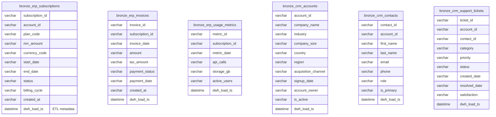

# Bronze Layer ERD

The Bronze layer represents the raw landing zone. Data here mirrors the source CSV structure identically. All fields are stored as flexible character types (e.g., `VARCHAR`, `NVARCHAR`) to ensure robust ingestion regardless of source data quality issues like mixed date formats or unexpected characters.

