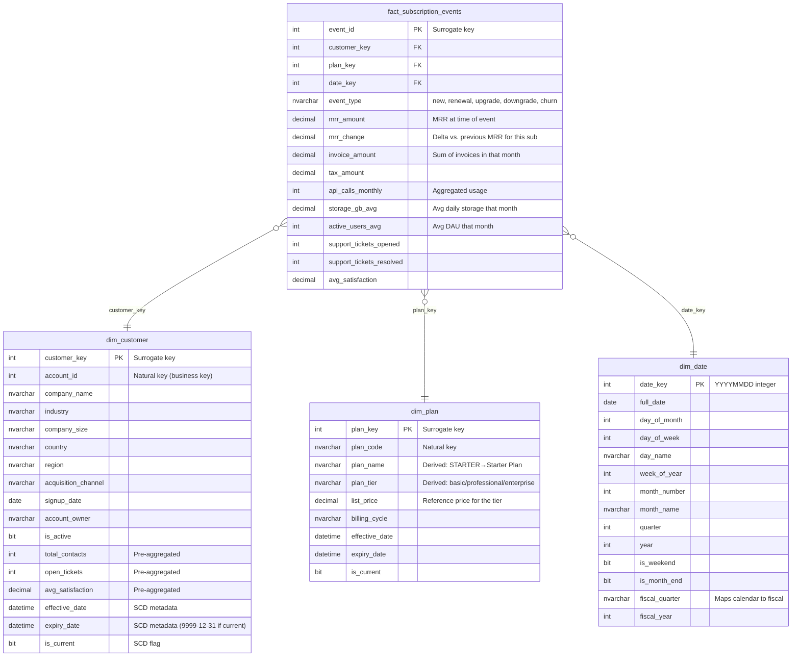

# Gold Layer ERD

The Gold layer uses dimensional modeling (star schema) for high-performance analytical queries. The fact table tracks monthly subscription events, joining with standardized dimension tables (`dim_customer`, `dim_plan`, `dim_date`) that manage historical context (SCD infrastructure).

