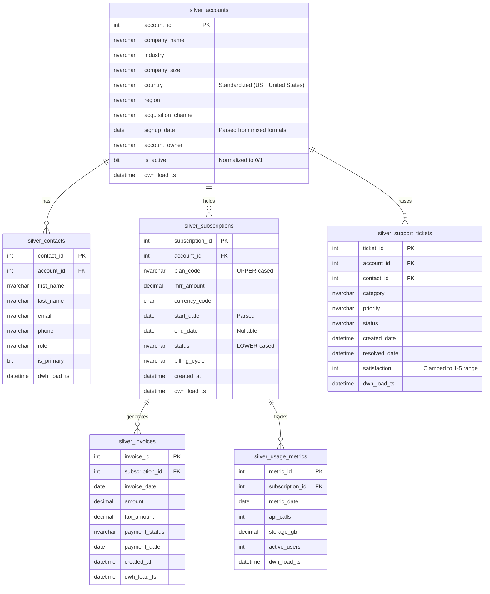

# Silver Layer ERD

The Silver layer enforces schema consistency, data types, and normalizes key business fields (like standardizing country names or fixing boolean flags). Referential integrity starts to take shape here, even if strict Foreign Key constraints are omitted to handle 'orphan' record logging gracefully.

