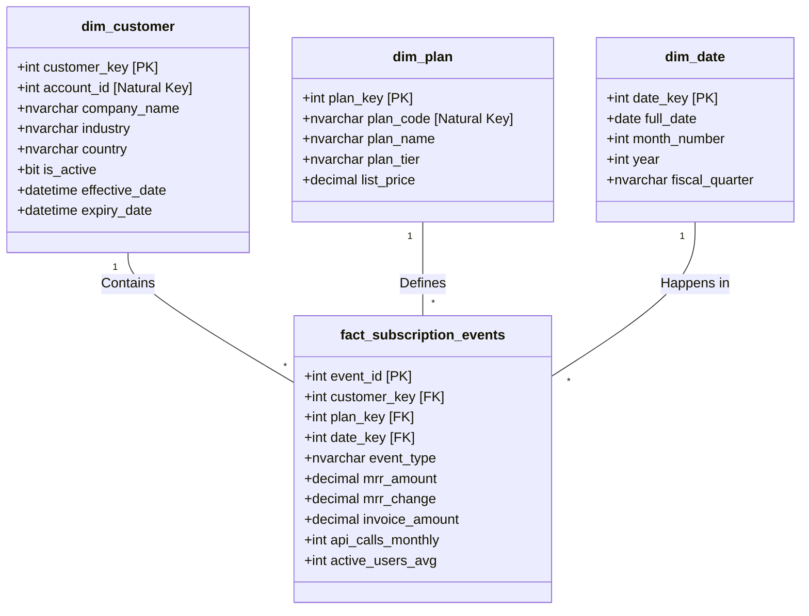

# Star Schema Design

This diagram represents the core Kimball dimensional modeling design (Star Schema) employed in the Gold layer of the NovaCRM Analytics Data Warehouse. It uses the `fact_subscription_events` table as the central point linking all dimensional context.

### Design Principles Used:
1. **Surrogate Keys**: Ensure data independence from operational source system keys and allows storing historical data (SCD).
2. **Conformed Dimensions**: `dim_date` handles logic for financial and calendar years across the organization.
3. **Monthly Snapshot / Event Grain**: The fact table rolls up daily data to a monthly event grain suitable for computing SaaS metrics (MRR, Churn) effectively.
